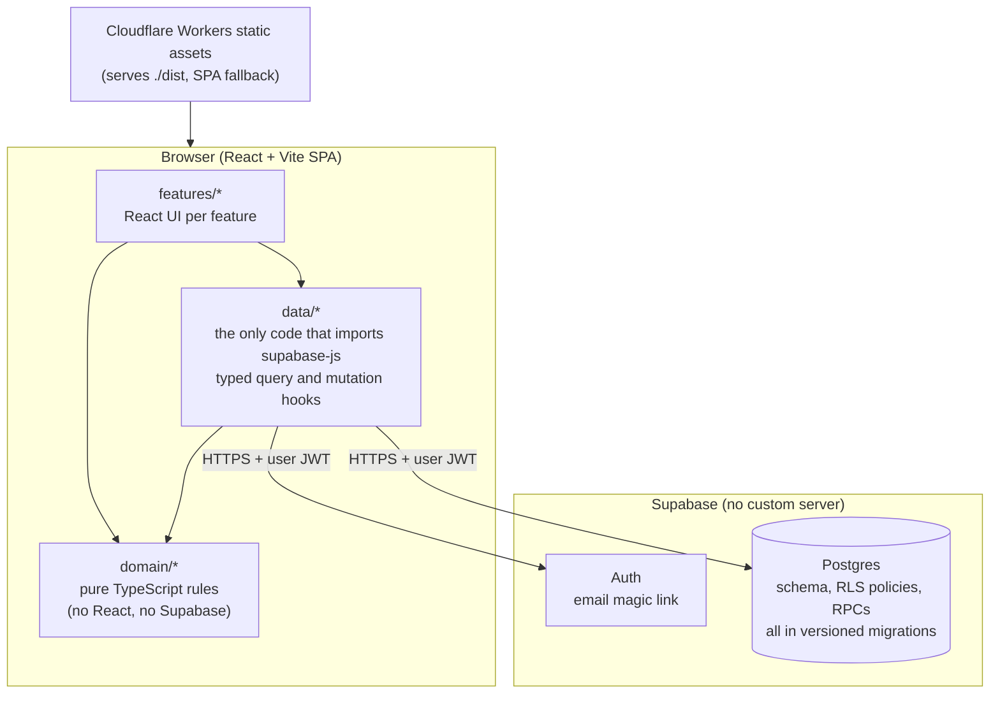
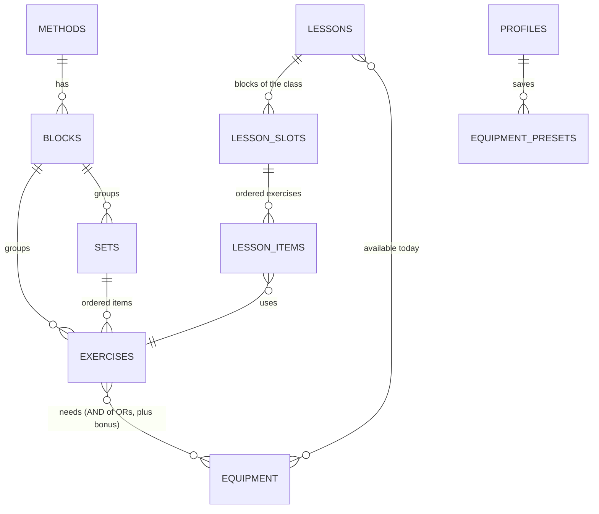

# Unda Flow

A Pilates **class planner** for instructors. You build a class from a library of exercises filtered by the equipment you have that day, see how the 45 minutes add up, follow it on your phone while teaching, and print it.

It is a portfolio project that is also used for real by one instructor. It is not a calendar and not a business: the goal is to make planning a class fast and pleasant.

> **Status:** feature-complete for the first release (Increments 0 to 4a in [PLAN.md](PLAN.md)). Next up: production readiness and an installable app (4b). The roadmap is below.

## What it does

- **Start from an example.** "New class" offers three ready-to-use 45-minute example classes (apparatus, classic mat, reformer and ball), your own earlier classes, or a blank one. Starting from a class copies it; the original is never touched.
- **Build a class** from blocks (warm-up, foot work, abdominal, ...). Each block has one **Add** button: tick any number of exercises, or add a whole **set** (a ready-made group of exercises). The library is filtered by the equipment ticked for the class, with unavailable exercises greyed and the missing equipment named.
- **Time.** Every exercise has a time. A sticky bar shows "32 of 45 min · 13 min left", or "overbooked by 5 min".
- **Teach view.** One exercise at a time in large type, with swipe, arrow keys and a screen kept awake, for use during the class.
- **Print** a one or two page PDF, with the logo and minutes per block.
- **Library** of shared exercises and sets, plus private exercises of your own. Equipment presets ("Studio", "Home") and custom blocks.
- **English and Hebrew** (right-to-left), a light and an olive dark theme, and a phone-first layout. Accessibility is tested automatically (axe, WCAG 2.0 to 2.2 A and AA, both themes, Hebrew).

## Architecture



**Row-level security is the security boundary.** The client holds only the publishable key and a user's session; every table has RLS enabled, and policies decide what each signed-in user can read and write. There is no application server to trust.

**One mechanism for shared and private content.** Content tables carry a nullable `owner_id`:

| `owner_id` | Meaning                                                           | Who can read         | Who can write |
| ---------- | ----------------------------------------------------------------- | -------------------- | ------------- |
| `NULL`     | Shared library content (blocks, exercises, sets, example classes) | every signed-in user | admins        |
| a user id  | Private to that user                                              | that user            | that user     |

So an **example class is just a class with no owner**, and "start from an example" is the same copy operation as "start from your own class".

### Layers

- `src/domain` is pure TypeScript with unit tests: equipment matching, time totals and status, filtering, the teach-view steps, schemas.
- `src/data` is the only code allowed to import `supabase-js` (an ESLint rule enforces it). Hooks there are optimistic where it matters (editing a class) and run one lesson's edits in order.
- `src/features` holds the UI per feature, written mobile-first with CSS logical properties only (so Hebrew and English share one layout). Colours come only from theme tokens, which is how the dark theme works.
- Methods are data: the block method is a row in `methods` with its blocks. There is no `if (method === ...)` in the UI.

### Data model (simplified)



- **Equipment matching:** an exercise is available when every "alternatives group" in its requirements has at least one item in the class's equipment (so `reformer AND (ball OR ring)` works). "Bonus" accessories are shown but never decide availability.
- **Classes copy their structure** (blocks, exercises, hints, settings) when created, so editing the original never changes a copy.
- **Reordering, copying and "add a whole set" are atomic database functions** (`security invoker`, so RLS still applies inside them).
- An exercise used in a class can't be deleted, only archived.

### Testing

| Layer         | Tooling                             | What it covers                                                                                                                                       |
| ------------- | ----------------------------------- | ---------------------------------------------------------------------------------------------------------------------------------------------------- |
| Database      | pgTAP (`supabase/tests/database`)   | RLS (user A can't read or write user B's data), shared vs private, the RPCs, the time rules                                                          |
| Domain and UI | Vitest + Testing Library            | rules, forms, components, contrast of both themes                                                                                                    |
| End to end    | Playwright against a local Supabase | real magic-link sign-in, building, teaching and printing a class, phone-width layout (no overflow), and an axe accessibility scan of every main page |

CI (GitHub Actions) runs typecheck, lint, unit tests, the build, the generated-types check, the database tests and the end-to-end suite on every pull request.

## Run it locally

Needs Node 22+ and Docker (for the local Supabase stack).

```
npm install
npm run db:start                 # prints the local API URL and publishable key
cp .env.example .env.local       # paste the URL and key into it
npm run db:reset                 # apply the migrations
npm run db:import                # sample exercises (the real list is private data)
npm run db:import-examples       # the example classes
npm run dev
```

Other commands (`npm test`, `npm run e2e`, `npm run db:test`, `npm run db:types`, ...) are listed in [CLAUDE.md](CLAUDE.md).

Secrets never go in the repo: the client uses only a publishable key, and the local import scripts use a secret key that stays on the developer's machine.

## Roadmap

The detailed plan is in [PLAN.md](PLAN.md). In order:

1. **4b: production readiness and an installable app.** A staging environment, scheduled backups with a tested restore, and a web app manifest and icons so it can be added to a phone's home screen (still online-only).
2. **5: more methods.** Seed the "dynamic" and "classic" methods with their blocks. This should need only data and small UI additions; if it needs more, a block-method assumption leaked into the code and gets fixed first.
3. **6: public readiness.** Open sign-up and onboarding, account deletion and data export, terms and privacy pages, error monitoring, rate limits.
4. **7: store apps.** A Capacitor wrapper around the same build, for TestFlight and Play.

Ideas on the backlog: equipment quantities against class size, translated exercise content, original exercise media, studios and teams, sharing a class by link, and suggesting a class from a template, equipment, level and what was taught recently.

## How it was built

In small, tested increments, each a vertical slice (migration, row-level security, data layer, UI, tests) deployed before the next one starts, with [PLAN.md](PLAN.md) as the source of truth and [CLAUDE.md](CLAUDE.md) holding the working conventions. The code was written with Claude Code as a pair programmer, which the commit history shows.

## Licence

The source code is licensed under the [PolyForm Noncommercial License 1.0.0](LICENSE): you may read it and use it for non-commercial purposes, but not commercially.

**The licence covers the code only.** The Unda Pilates name, logo and brand assets are private property, all rights reserved, and are not licensed for any use.

The exercise library is not part of this repository's data: the committed seed files contain only a small sample and exercises written for this project. The instructor's full exercise list is private.
